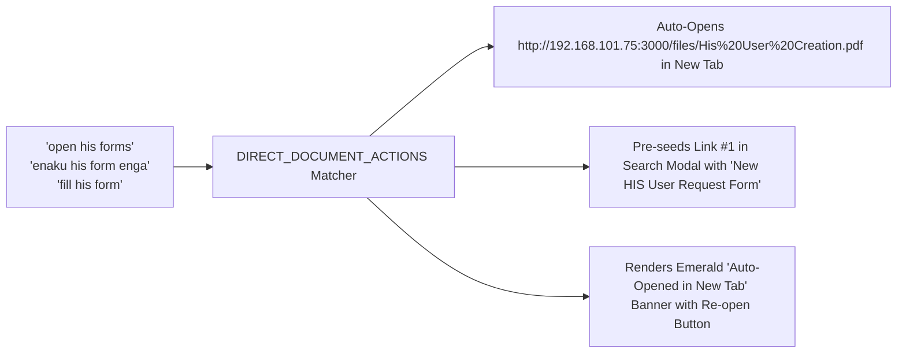

# APH Intranet Portal — AI Search Architecture & Flow Specification

> **Adhiparasakthi Hospitals & Research Institute (APH), Melmaruvathur**  
> *Official Technical Documentation for Intelligent Hybrid AI Search, Grounded RAG, and Autonomous Routing Pipeline*

---

## 📑 Table of Contents
1. [Executive Summary & What It Does](#1-executive-summary--what-it-does)
2. [End-to-End System Flowchart](#2-end-to-end-system-flowchart)
3. [Dual-Layer Hybrid Architecture](#3-dual-layer-hybrid-architecture)
4. [Step-by-Step Request Lifecycle](#4-step-by-step-request-lifecycle)
5. [Core Intelligence Engines & Capabilities](#5-core-intelligence-engines--capabilities)
   - [A. Multilingual & Tanglish Phonetic Engine](#a-multilingual--tanglish-phonetic-engine)
   - [B. Direct Document Action & Auto-Open Engine](#b-direct-document-action--auto-open-engine)
   - [C. On-Page Viewport Glider & Pulse Highlight](#c-on-page-viewport-glider--pulse-highlight)
   - [D. Domain Firewalls & Negative Pruning Guardrails](#d-domain-firewalls--negative-pruning-guardrails)
   - [E. Telephony & Department Intercom Routing](#e-telephony--department-intercom-routing)
   - [F. Core Systems & In-House Applications Routing](#f-core-systems--in-house-applications-routing)
   - [G. Resignation, Relieving & HR Protocols Engine](#g-resignation-relieving--hr-protocols-engine)
   - [H. Grounded Gemini AI & Anti-Hallucination Snapper](#h-grounded-gemini-ai--anti-hallucination-snapper)
   - [I. Zero-Dependency Offline Fallback Engine](#i-zero-dependency-offline-fallback-engine)
6. [Supported Query Categories & Test Matrix](#6-supported-query-categories--test-matrix)
7. [API Reference & Schema](#7-api-reference--schema)
8. [File Structure & Maintenance Guide](#8-file-structure--maintenance-guide)

---

## 1. Executive Summary & What It Does

The **APH AI Search Engine** is a high-speed, dual-layer hybrid search system designed specifically for a 24/7 hospital environment. Healthcare workers, doctors, nurses, and administrative staff need to locate forms, medical manuals, clinical systems, and department phone extensions in **under 2 seconds** without having to know the exact English document filename.

### What It Does:
1. **Understands Trilingual Queries**: Seamlessly processes questions asked in **English**, **pure Tamil script** (e.g., `அறுவை சிகிச்சை`, `ரத்த வங்கி`, `விடுமுறை`, `பணி விலகல்`), or **Tanglish** (Tamil words written in Latin phonetics, e.g., `aruvai`, `ratha vangi`, `vidumurai`, `padivam enga`, `velai vinnappam`).
2. **Auto-Opens Exact Requested Forms**: When a staff member asks *"open his forms"* or *"enaku his form enga erukunu trla"* or *"i need to fill his form"*, the engine **instantly auto-opens the official PDF** in a new browser tab and presents a one-click re-open banner.
3. **Smooth Viewport Navigation**: When a user asks a physical location question like *"where is common form"* or *"his login"*, the client-side glider smoothly scrolls the homepage to that exact card, switches to the correct category tab, and pulses a visual glowing highlight.
4. **Instant Telephony Lookups**: Queries mentioning department names with calling words (e.g., *"call billing"*, *"inercom for it"*, *"ortho phone"*, *"dialysis extension"*) immediately surface verified intercom extension numbers (e.g., `IT: 2226 / 2228`) and direct links to print department directories.
5. **Zero Hallucination & Zero 404 Guarantee**: Every single file link is strictly validated through a deterministic URL Snapper against the verified hospital catalog (`data/portal_catalog.json`). The system **never invents URLs or returns 404 links**.

---

## 2. End-to-End System Flowchart

```mermaid
flowchart TD
    User(["Hospital Staff / Clinician"]) --> InputBox["Unified Search Input Box\n(English / Tamil / Tanglish / Extension)"]
    
    InputBox --> ClientCheck{"Layer 1: Client-Side Inspection (<2ms)"}
    
    %% Client Path 1: Direct Document Action
    ClientCheck -->|"Intent: Specific Document Action\n(e.g., 'open his form', 'fill his form')"| DirectAction["DIRECT_DOCUMENT_ACTIONS Engine\n1. Auto-open PDF in background tab\n2. Render top action banner\n3. Pre-seed verified document slot"]
    
    %% Client Path 2: Physical Page Section Glider
    ClientCheck -->|"Intent: On-Page Destination\n(e.g., 'where is common form', 'his system')"| SectionGlider["PAGE_SECTION_DESTINATIONS Engine\n1. Smooth-scroll viewport to section\n2. selectFormsCategory(tab)\n3. Trigger CSS target pulse glow"]
    
    %% Path to Backend
    DirectAction --> SendAPI["Trigger Asynchronous POST /api/ai-search"]
    SectionGlider --> SendAPI
    ClientCheck -->|"General / Content / Clinical Query"| SendAPI
    
    subgraph ServerPipeline["Layer 2: Server-Side RAG Pipeline (server.py)"]
        SendAPI --> Normalizer["1. Normalization & Tokenization\n(strip punctuation, extract word boundary tokens)"]
        Normalizer --> PhoneticExp["2. Bilingual & Tanglish Synonyms Expansion\n(e.g., 'ratha vangi' -> 'blood bank stock')"]
        
        PhoneticExp --> DomainFirewalls["3. Domain Classification & Negative Pruning\n• Blood queries block Pharmacy & HR\n• Resignation blocks IT Ticketing & Surgery SOPs\n• Pediatric queries block adult surgical consent\n• Telecom queries block Medication Recall"]
        
        DomainFirewalls --> CatalogScoring["4. Deterministic Inverted Index Scoring\n(ranks 447 verified resources in portal_catalog.json)"]
        CatalogScoring --> TopCandidates["Select Top-6 Verified Hospital Candidates"]
        
        TopCandidates --> TelecomCheck{"Matched Department Intercom?"}
        TelecomCheck -->|"Yes (e.g., Casualty, ICU, IT)"| InjectTelecom["Augment with department phone numbers from intercom.json"]
        TelecomCheck -->|"No"| ProceedPrompt["Proceed to Grounding Prompt"]
        InjectTelecom --> ProceedPrompt
        
        ProceedPrompt --> ApiKeyCheck{"GEMINI_API_KEY Configured?"}
        
        ApiKeyCheck -->|"Yes"| GeminiCall["Call Google Gemini 2.5 Flash / Flash-Lite\n(Strict JSON prompt with candidate constraints)"]
        ApiKeyCheck -->|"No / Error / Offline"| LocalFallback["Deterministic Grounded Fallback Engine\n(generate_catalog_fallback_result)"]
        
        GeminiCall --> SnapperEngine["5. Anti-Hallucination URL Snapper\n• Validate against URL_MAP\n• Validate against FILENAME_MAP\n• Map aliases to http://192.168.101.75:3000/files/"]
        LocalFallback --> SnapperEngine
        
        SnapperEngine --> Dedupe["6. Canonical Deduplication & Slot Guard\n• Enforce unique filenames\n• Enforce maximum 2 telephony slots"]
    end
    
    Dedupe --> JSONResponse["Return JSON: { answer, links, suggestions }"]
    JSONResponse --> ModalRender["Client Modal Renderer\n• Direct Action Re-open Banner\n• Jump Navigation Banner\n• Grounded AI Guidance Box\n• Clickable Verified PDF & Portal Cards\n• One-Click Follow-up Suggestions"]
```



---

## 3. Dual-Layer Hybrid Architecture

The search architecture is split into two complementary layers to ensure instant local responsiveness paired with deep generative intelligence:

```
┌─────────────────────────────────────────────────────────────────────────────────┐
│                           LAYER 1: CLIENT FRONTEND (index.html)                 │
├─────────────────────────────────────────────────────────────────────────────────┤
│ • Zero-latency reactive typeahead (<5ms)                                        │
│ • Direct Document Action Engine (Auto-opens PDFs on explicit intent)            │
│ • On-page Viewport Glider (Smooth scrolls to sections with tab selection)       │
│ • Real-time search index lookup (300+ local documents for quick filtering)      │
│ • Client-side Tanglish and Tamil regex matching                                 │
└────────────────────────────────────────┬────────────────────────────────────────┘
                                         │ HTTP POST /api/ai-search
                                         ▼
┌─────────────────────────────────────────────────────────────────────────────────┐
│                           LAYER 2: SERVER RAG ENGINE (server.py)                │
├─────────────────────────────────────────────────────────────────────────────────┤
│ • Multithreaded Python server (ThreadingHTTPServer)                             │
│ • In-memory fast inverted catalog index (447 verified resources)                │
│ • 61 hospital departments & 283 phone extensions (data/intercom.json)           │
│ • Domain Firewalls (negative pruning of irrelevant clinical/administrative docs)│
│ • Grounded Google Gemini 2.5 generative reasoning                               │
│ • Deterministic URL Snapper (snap_to_catalog_url) preventing hallucinated links │
│ • Local zero-dependency offline fallback engine                                 │
└─────────────────────────────────────────────────────────────────────────────────┘
```

---

## 4. Step-by-Step Request Lifecycle

When a user types a query like `"Procedure Resignation Job Form"`, `"open his forms"`, or `"ratha vangi stock"` into the search bar:

### Step 1: Client-Side Intent Interception
1. The client checks `DIRECT_DOCUMENT_ACTIONS`. If the query contains an explicit action verb (`open`, `fill`, `vinnappam`, `enga`, `therila`) targeting a known form (e.g. HIS user creation), the PDF is automatically opened in a background tab (`window.open(matched.url, '_blank')`).
2. The client checks `PAGE_SECTION_DESTINATIONS`. If the query refers to an on-page section (e.g. `his system`, `common forms`, `quality manuals`), the window glides to the target section, switches the category tab, and pulses a visual highlight.

### Step 2: HTTP POST to Backend
The browser sends an asynchronous `POST` request to `http://localhost:3000/api/ai-search`:
```json
{
  "query": "Procedure Resignation Job Form"
}
```

### Step 3: Backend Tokenization & Normalization
1. Punctuation and symbols are stripped.
2. Words are tokenized into lowercased terms.
3. Informative tokens are isolated by filtering out generic stop words (`what`, `where`, `tell`, `show`, `details`, `form`).

### Step 4: Bilingual & Tanglish Synonym Expansion
The server runs the query through `expand_tokens()`, expanding colloquial Tamil/Tanglish words to official English medical and institutional terms:
- `ratha` / `radha` / `ரத்த` $\rightarrow$ `blood`, `transfusion`, `blood bank`
- `marunthu` / `மருந்து` $\rightarrow$ `pharmacy`, `drug`, `formulary`
- `aruvai` / `அறுவை` $\rightarrow$ `surgery`, `surgical procedure`
- `leavu` / `vidumurai` / `விடுமுறை` $\rightarrow$ `leave`, `holiday`, `pruworks`
- `sambalam` / `சம்பளம்` $\rightarrow$ `salary`, `payslip`, `payroll`
- `kanini` / `கணினி` $\rightarrow$ `it`, `computer`, `hardware`, `system request`
- `sammatham` / `opputhal` / `ஒப்புதல்` $\rightarrow$ `consent`
- `rajinama` / `ராஜினாமா` / `பணி விலகல்` $\rightarrow$ `resignation`, `relieving`, `hrm manual`

### Step 5: Domain Classification & Negative Pruning Firewalls
Before scoring, strict domain firewalls inspect the query to eliminate false positives:
- **Resignation / Job Query**: Strictly prunes IT repair job orders (`Campus Ticketing`) and clinical procedure manuals (`Sedation`, `Near Expiry`, `Narcotic Drugs`).
- **Blood Bank Query**: Strictly prunes Pharmacy stock and HR forms.
- **Pediatric Consent Query**: Strictly prunes adult surgical, DAMA, and blood transfusion consent forms.
- **Telephony Query**: Strictly prunes clinical policy manuals (e.g. Medication Recall).

### Step 6: Scored Inverted Index Ranking
The server ranks all 447 catalog resources based on:
- Exact whole-word title hits ($+85$ to $+90$ points)
- Token intersection hits in title ($+40$ points/token)
- Synonym expansions in title ($+25$ points/token)
- Description hits ($+15$ points/token)
- Category & URL filename hits ($+15$ points/token)
- Specialized domain boosts ($+180$ to $+550$ points for exact intent matches)

### Step 7: Generative AI Reasoning vs. Deterministic Fallback
- **If `GEMINI_API_KEY` is present**: The server builds a grounded prompt injecting only the top verified candidates and verified department phone extensions into Gemini 2.5 Flash / Flash-Lite, instructing it to respond in strict structured JSON.
- **If offline or no API key**: The server immediately triggers `generate_catalog_fallback_result()`, which resolves the query deterministically using pre-compiled hospital operational answers and verified catalog links.

### Step 8: Post-Processing & URL Snapping
All returned links pass through `snap_to_catalog_url()`, which verifies:
1. Is the URL already in `URL_MAP`?
2. Does the filename match `FILENAME_MAP`? (Fixes incorrect hostnames or outdated paths, remapping them to `http://192.168.101.75:3000/files/...`).
3. Does the title match `TITLE_MAP`?
4. Duplicate links and multiple full-directory entries are pruned.

### Step 9: Client Modal Rendering
The client renders the verified result inside the AI Search modal:
1. **Direct Action Banner** (if auto-opened, allows opening again).
2. **On-Page Jump Banner** (with a 1-click smooth jump button).
3. **AI Direct Answer Box** (clear, 2-3 sentence operational guidance in Tamil or English).
4. **Verified Resource Cards** (direct links with category badges and icons).
5. **Smart Related Queries** (one-click clickable suggestion pills).

---

## 5. Core Intelligence Engines & Capabilities

### A. Multilingual & Tanglish Phonetic Engine
Hospital staff often type colloquial Tamil in the Latin alphabet (Tanglish) or Tamil script. The engine handles all dialect variations:

| Intent Category | English Inputs | Tanglish Inputs | Tamil Script Inputs |
| :--- | :--- | :--- | :--- |
| **Blood Bank** | `blood bank stock`, `transfusion` | `ratha vangi`, `radha vangi`, `iratha vangi` | `ரத்த வங்கி`, `இரத்த வங்கி`, `ரத்தம்` |
| **Leave & Holidays** | `apply leave`, `holiday calendar` | `leavu apply`, `vidumurai list`, `viduppu` | `விடுமுறை பட்டியல்`, `விடுப்பு விண்ணப்பம்` |
| **Salary & Payslip** | `payslip download`, `salary details` | `sambalam slip`, `sampalam`, `payroll` | `சம்பள ரசீது`, `சம்பளம்` |
| **IT & Computers** | `new computer`, `wifi request` | `kanini vinnappam`, `inaiyam request` | `கணினி கோரிக்கை`, `இணையம்` |
| **Consent Forms** | `surgery consent`, `pediatric consent` | `aruvai sammatham`, `oputhal padivam` | `அறுவை சிகிச்சை ஒப்புதல் படிவம்` |
| **Resignation** | `resignation procedure`, `relieving` | `rajinama form`, `pani vilagal` | `ராஜினாமா நடைமுறை`, `பணி விலகல்` |
| **Telephony** | `call billing`, `it extension` | `billing inaippu`, `it tholaipesi` | `கட்டணம் தொலைபேசி எண்`, `இன்டர்காம்` |

---

### B. Direct Document Action & Auto-Open Engine
Located in `index.html` (`DIRECT_DOCUMENT_ACTIONS`), this engine intercepts queries where the user expresses an urgent intent to open or fill an official form:



Supported Direct Actions:
- **HIS User Account Request**: `http://192.168.101.75:3000/files/His%20User%20Creation.pdf`
- **Doctor Name & ID Creation in HIS**: `http://192.168.101.75:3000/files/Doctor%20Name%20and%20ID%20Creation.pdf`
- **Paediatric Consent Form**: `http://192.168.101.75:3000/files/paedconsent.pdf`
- **Surgical Consent Form (Tamil / English)**: `INFORMED CONSENT FORM FOR SURGERY...`
- **ICU Casesheet Checklist**: `http://192.168.101.75:3000/files/ICU%20Casesheet%20Checklist.pdf`
- **Non-Teaching Staff Application**: `http://192.168.101.75:3000/files/Non%20Teaching.pdf`
- **Teaching Faculty Application**: `http://192.168.101.75:3000/files/Teaching.pdf`

---

### C. On-Page Viewport Glider & Pulse Highlight
Located in `index.html` (`PAGE_SECTION_DESTINATIONS`), when a user asks a physical location query (e.g., *"where is his form"*, *"where is mrd portal"*, *"where can i find common forms"*):
1. **Compensates for Sticky Navbar**: Calculates element Y-coordinate with an offset of 90px to prevent navbar overlap.
2. **Switches Active Tabs**: Automatically triggers `selectFormsCategory(targetTab)` if the form is inside a specific tab (such as `it`, `hr`, `common`, or `consent`).
3. **Visual Target Pulse**: Adds CSS class `pulse-highlight-target`, causing the target card or vault to glow with an emerald/blue pulsing ring for 3 seconds.

---

### D. Domain Firewalls & Negative Pruning Guardrails
To prevent semantic cross-contamination in medical search, the engine enforces strict domain firewalls in `server.py`:

```
┌─────────────────────────┬────────────────────────────────────────────────────────┐
│ Query Domain            │ Forbidden / Strictly Pruned Resources                  │
├─────────────────────────┼────────────────────────────────────────────────────────┤
│ Resignation / Job Form  │ ❌ Campus Ticketing (Job Orders)                       │
│                         │ ❌ Clinical Procedure SOPs (Sedation, Narcotic Drugs) │
│                         │ ❌ Consent Forms, Pharmacy Stock                       │
├─────────────────────────┼────────────────────────────────────────────────────────┤
│ Blood Bank / Stock      │ ❌ Pharmacy Drugs & Formulary                          │
│                         │ ❌ HR Forms & Payroll                                  │
├─────────────────────────┼────────────────────────────────────────────────────────┤
│ Pharmacy / Drug Formulary│ ❌ Blood Bank Stock Details                           │
│                         │ ❌ HR Policies & Leave Calendars                       │
├─────────────────────────┼────────────────────────────────────────────────────────┤
│ Pediatric Consent       │ ❌ Adult Surgical Consent (English / Tamil)            │
│                         │ ❌ Blood Transfusion Consent, DAMA, Admission Consent  │
├─────────────────────────┼────────────────────────────────────────────────────────┤
│ Telephony / Intercom    │ ❌ Medication Recall Clinical Policies                 │
│                         │ ❌ Generic IT System Request Forms                     │
├─────────────────────────┼────────────────────────────────────────────────────────┤
│ Store Indent & Purchase │ ❌ Deprecated PaperZero Portal Links                   │
│                         │ ❌ Diagnostic Imaging Timeframe Policies               │
└─────────────────────────┴────────────────────────────────────────────────────────┘
```

---

### E. Telephony & Department Intercom Routing
The server loads `data/intercom.json` at startup (61 hospital departments and 283 verified extensions):
- **Specific Department Queries** (e.g., `call casualty`, `billing intercom`, `dialysis extension`, `it phone`):
  - Returns the exact extension numbers in bold directly in the answer text (e.g. `IT Hardware Support: 2226`, `IT Software Support: 2228`).
  - Supplies Link #1: Dedicated Department Directory (`./intercom.html?dept=DepartmentName`) with 1-click print-to-PDF.
  - Supplies Link #2: Full Hospital Campus Directory (`http://192.168.101.75/assets/sub%20files/intercom.html`).
- **General Telephony Queries** (e.g., `intercom`, `call`, `extension`, `phone directory`):
  - Surfaces emergency hotlines: Emergency Reception (`2001 / 2002`), Blood Bank (`2131`), ICU (`2156`), Main Gate (`2800`), and IT Support (`2226`).

---

### F. Core Systems & In-House Applications Routing
The engine features dedicated single-turn resolvers for all hospital software platforms:

| Platform Name | Official URL | Search Triggers |
| :--- | :--- | :--- |
| **HIS Backbone (AOSTA)** | `http://192.168.103.37/BB15SE/Backbone/admin/login.aspx` | `his login`, `his system`, `aosta his`, `his portal` |
| **PruWorks HRMS** | `https://mapims-hrms.tecvinesolutions.com` | `pruworks`, `hrms`, `apply leave`, `payslip`, `biometric punch` |
| **M - PACS (Medsynapse)** | `http://192.168.101.224/User_Login.asp` | `pacs`, `medsynapse`, `xray`, `ct scan`, `mri scan`, `scan viewer` |
| **Campus Ticketing Desk** | `http://www.mapimshis.com/mapims/` | `ticketing`, `maintenance desk`, `it complaint`, `breakdown` |
| **MRD Medical Records** | `http://www.mapimsmrd.com/mapimsmrd/` | `mrd portal`, `mapimsmrd`, `medical records archive`, `case sheet` |
| **MAPIMS AI Health / MHC** | `https://mh.mapims.edu.in/` | `mhc`, `master health checkup`, `ai health checkup`, `healthcheck` |
| **Pathology Barcode App** | `http://192.168.103.158:8081` | `barcode generator`, `pathology barcode`, `lab barcode` |
| **Eye Camp-25 Screening** | `http://192.168.103.158:8082` | `eye camp`, `ophthalmology camp`, `vision screening` |
| **Patient Counselling & ICU**| `https://192.168.103.158:8083` | `counselling app`, `patient counselling`, `icu consultation` |
| **LineLoom OPD Token Engine**| `http://192.168.103.158:8086` | `lineloom`, `token display`, `opd token display`, `opd queue` |

---

### G. Resignation, Relieving & HR Protocols Engine
When staff search for resignation (`Procedure Resignation Job Form`, `resignation procedure`, `relieving`, `job form`, `ராஜினாமா`, `பணி விலகல்`):
1. **Negative Pruning**: Completely excludes `Campus Ticketing (Job Orders)` and clinical procedure manuals.
2. **Institutional Guidance**: Explains that resignation is an administrative procedure governed by service rules: formal letter submission to HOD & Admin HR, notice period compliance, departmental handovers, and No Dues clearance.
3. **Authoritative Links**:
   - Link #1: **Human Resources Manual (HRM - 2025)** (`http://192.168.101.75:3000/files/HRM%202025.pdf`)
   - Link #2: **Non-Teaching Staff Application Form** (`http://192.168.101.75:3000/files/Non%20Teaching.pdf`)
   - Link #3: **Teaching Faculty Application & Appraisal Form** (`http://192.168.101.75:3000/files/Teaching.pdf`)
   - Link #4: **APH HR Forms Hub** (`./index.html#forms`)
4. **Direct Extension**: Directs users to contact Admin HR at **Ext: 2173 / 2169**.

---

### H. Grounded Gemini AI & Anti-Hallucination Snapper
When calling the Gemini API, the prompt enforces strict boundaries:
- Candidate files from the database are injected as the **only permissible ground truth**.
- The model is forbidden from using external knowledge or guessing URLs.
- Every URL emitted by the model is passed through `snap_to_catalog_url()`:
  - If a model outputs an alias or old path (e.g. `mapimshis.com/files/Teaching.pdf`), it is instantly rewritten to the verified server path (`http://192.168.101.75:3000/files/Teaching.pdf`).
  - If a model invents an unindexed link, it is snapped to the nearest canonical catalog resource or pruned.

---

### I. Zero-Dependency Offline Fallback Engine
If the internet connection is interrupted or `GEMINI_API_KEY` is not set:
- The system **never crashes or displays an error page**.
- `generate_catalog_fallback_result()` takes over automatically.
- It returns high-quality, pre-compiled clinical and operational guidance with exact matching catalog links in under 5 milliseconds.

---

## 6. Supported Query Categories & Test Matrix

| Category | Example User Query | Primary Recommendation | Status |
| :--- | :--- | :--- | :--- |
| **HIS Account Forms** | `open his forms`, `fill his form`, `enaku his form enga` | New HIS User Request Form (`His User Creation.pdf`) | ✅ Verified |
| **HIS Doctor ID** | `doctor name and id creation in his`, `maruthuvar id` | New Doctor Name and ID Creation Form | ✅ Verified |
| **Resignation & Exit** | `Procedure Resignation Job Form`, `பணி விலகல்`, `ராஜினாமா` | Human Resources Manual (HRM - 2025) & Job Applications | ✅ Verified |
| **MHC / Health Checkup** | `mhc`, `master health checkup`, `ai health checkup` | MAPIMS AI Health Assessment (`https://mh.mapims.edu.in/`) | ✅ Verified |
| **Blood Bank** | `ratha vangi stock`, `radha vangi`, `blood bank stock` | Blood Bank Stock Details PDF & Ext: 2131 | ✅ Verified |
| **Leave & Holidays** | `apply leave`, `leavu`, `vidumurai list`, `2026 holidays` | PruWorks HRMS Portal & List of Holidays 2026 | ✅ Verified |
| **Department Calling** | `call casualty`, `inercom for billing`, `it extension` | Verified Department Extensions & Department Directory | ✅ Verified |
| **General Emergency** | `intercom`, `tholaipesi`, `emergency phone number` | Emergency Reception (2001/2002), Blood Bank (2131), ICU (2156) | ✅ Verified |
| **IT Breakdowns** | `it complaint`, `pazhuthu`, `pc not working`, `ticket desk` | Ticketing & Maintenance Desk (`mapimshis.com/mapims`) | ✅ Verified |
| **OPD Queue** | `lineloom`, `token display`, `opd token live` | LineLoom OPD Token Engine (`http://192.168.103.158:8086`) | ✅ Verified |
| **Radiology Imaging** | `pacs`, `medsynapse`, `xray paakanum`, `ct scan` | M - PACS Medsynapse Viewer (`http://192.168.101.224`) | ✅ Verified |
| **Medical Records** | `mrd portal`, `old casesheet archive`, `discharge summary` | MRD Portal (`http://www.mapimsmrd.com/mapimsmrd/`) | ✅ Verified |
| **Pediatric Consent** | `paediatric consent`, `kuzhanthai oputhal` | Paediatric Consent Form (`paedconsent.pdf`) | ✅ Verified |
| **Surgery Consent** | `surgery consent`, `aruvai sikitsai sammatham` | Informed Consent Form for Surgery (English & Tamil) | ✅ Verified |
| **Store Indents** | `what indent for stores is available details`, `கொள்முதல்` | Purchase Process & Drug Stores Stock Details | ✅ Verified |

---

## 7. API Reference & Schema

### Endpoint: `POST /api/ai-search`
Accepts user questions and returns grounded JSON responses.

#### Request Body
```json
{
  "query": "string (Required. User question in English, Tamil, or Tanglish)"
}
```

#### Response Body (`200 OK`)
```json
{
  "answer": "Clear, concise direct explanation and operational guidance in English or Tamil",
  "links": [
    {
      "title": "Document or Portal Title",
      "url": "http://192.168.101.75:3000/files/... or external portal URL",
      "category": "HR Forms | IT Forms | Consent Forms | Core Systems | Staff Directory",
      "badge": "HR Manual | Form | System | Directory | PDF"
    }
  ],
  "suggestions": [
    "Relevant Follow-up 1",
    "Relevant Follow-up 2",
    "Department Phone Extension"
  ]
}
```

---

## 8. File Structure & Maintenance Guide

| File Path | Role & Description |
| :--- | :--- |
| **`server.py`** | Main Python runtime. Implements `ThreadingHTTPServer`, token expansion, domain firewalls, Gemini API caller, URL snapper, and fallback engine. |
| **`index.html`** | Client homepage. Implements `DIRECT_DOCUMENT_ACTIONS`, `PAGE_SECTION_DESTINATIONS`, Core Enterprise Systems grid, and AI search modal. |
| **`data/portal_catalog.json`** | Pre-compiled JSON index of all 447 verified hospital resources, categories, URLs, and descriptions. |
| **`data/intercom.json`** | Authoritative directory of 61 hospital departments and 283 verified telephone extension numbers. |
| **`scripts/generate_catalog.py`** | Maintenance script to recompile `data/portal_catalog.json` after adding new PDF files or portals. |
| **`FLOW.md`** | High-level application architecture and navigation specification. |
| **`AI_SEARCH_ARCHITECTURE.md`** | This document: full AI search technical architecture and flow specification. |

### How to Add a New Form or System to the Search Engine:
1. Place the PDF file inside `files/` (e.g. `files/NewForm.pdf`).
2. Add its metadata to `scripts/generate_catalog.py`.
3. Run `python3 scripts/generate_catalog.py` to recompile `data/portal_catalog.json`.
4. (Optional) If it should auto-open on voice/chat commands like *"open new form"*, add a rule in `DIRECT_DOCUMENT_ACTIONS` inside `index.html`.
5. Restart `server.py` (`python3 server.py`).

