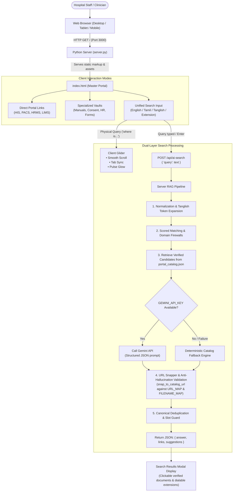
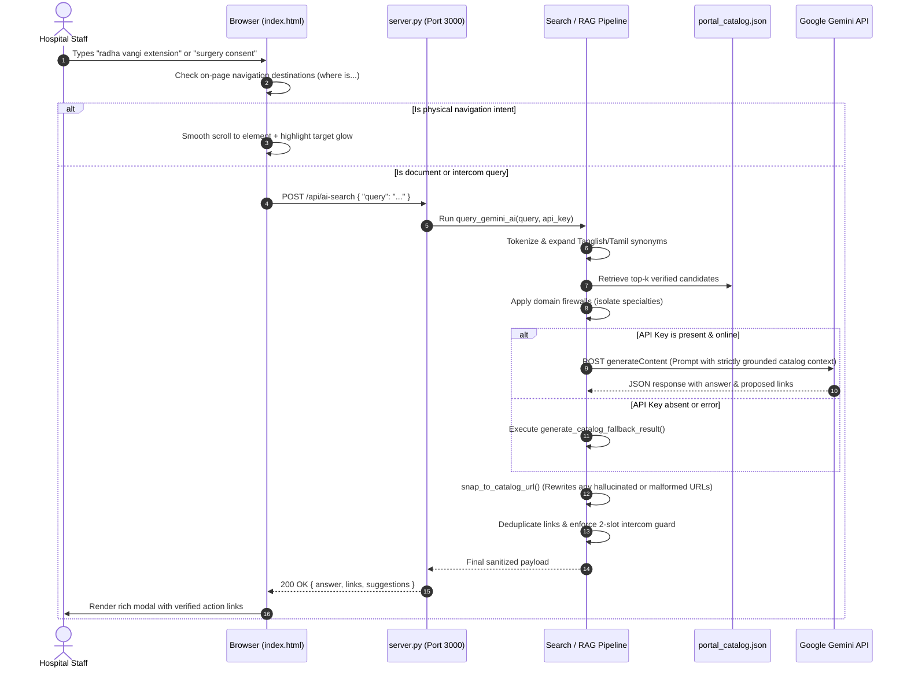
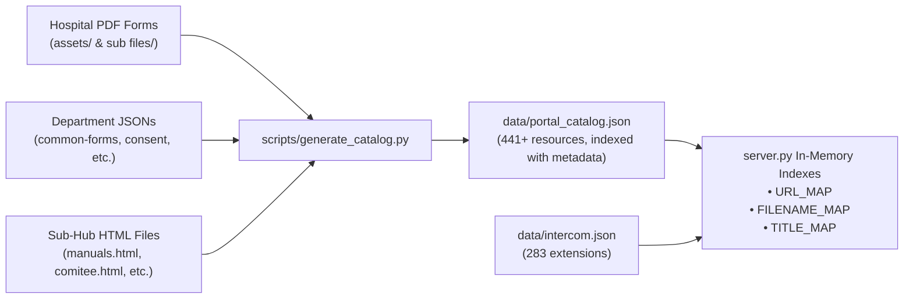

# Adhiparasakthi Hospitals & Research Institute (APH) Intranet Portal
## Complete Application & Data Flow Architecture Specification

This document provides an end-to-end walkthrough of how the **APH Intranet Portal** functions, from user interaction to backend processing, search indexing, and AI orchestration.

---

## 📑 Table of Contents
1. [High-Level Architecture Overview](#1-high-level-architecture-overview)
2. [End-to-End System Flow Diagram](#2-end-to-end-system-flow-diagram)
3. [User Journey & Navigation Flows](#3-user-journey--navigation-flows)
   - [Flow A: Enterprise Systems Access](#flow-a-enterprise-systems-access)
   - [Flow B: Forms & Documents Vault](#flow-b-forms--documents-vault)
   - [Flow C: Accreditation & Governance](#flow-c-accreditation--governance)
   - [Flow D: Telephony & Emergency Directory](#flow-d-telephony--emergency-directory)
4. [Hybrid Search Engine & AI Flow](#4-hybrid-search-engine--ai-flow)
   - [Detailed Sequence Diagram](#detailed-search-sequence-diagram)
   - [Phonetic & Tanglish Expansion](#phonetic--tanglish-expansion)
   - [Anti-Hallucination & URL Snapping](#anti-hallucination--url-snapping)
5. [Data Lifecycle & Catalog Generation Flow](#5-data-lifecycle--catalog-generation-flow)
6. [Backend Server Runtime Flow (`server.py`)](#6-backend-server-runtime-flow-serverpy)
7. [Quick Reference & File Map](#7-quick-reference--file-map)

---

## 1. High-Level Architecture Overview

The APH Portal is engineered as a **lightweight, zero-build, dual-layer architecture**:

```
┌────────────────────────────────────────────────────────────────────────┐
│                        CLIENT FRONTEND LAYER                           │
│  • index.html (Master Hub)       • consent.html     • manuals.html     │
│  • commonforms.html              • hrforms.html     • itforms.html     │
│  • intercom.html                 • comitee.html     • recent circular  │
│  • Tailwind CSS (v3+)            • Vanilla JS (ES6) • Responsive UI    │
└───────────────────────────────────┬────────────────────────────────────┘
                                    │ HTTP Requests / REST
                                    ▼
┌────────────────────────────────────────────────────────────────────────┐
│                        BACKEND SERVICE LAYER                           │
│                    server.py (Python 3 HTTP Server)                    │
│  • Port 3000 (0.0.0.0)             • Path resolution (/files/ remapping)│
│  • CORS & Security Headers        • /api/ai-search & /api/search       │
└───────────────────┬────────────────────────────────┬───────────────────┘
                    │                                │
                    ▼                                ▼
┌───────────────────────────────────┐ ┌───────────────────────────────────┐
│     GROUNDED RAG & AI ENGINE      │ │       DATA CATALOG LAYER          │
│ • In-Memory Fast Inverted Index   │ │ • data/portal_catalog.json (441+) │
│ • Tanglish & Tamil Dictionaries   │ │ • data/intercom.json (283 ext)    │
│ • Domain Firewalls (pruning)      │ │ • scripts/generate_catalog.py     │
│ • Google Gemini API (2.5/Flash)   │ │ • Official Hospital PDF Vaults    │
│ • Deterministic URL Snapper       │ │                                   │
└───────────────────────────────────┘ └───────────────────────────────────┘
```

---

## 2. End-to-End System Flow Diagram



---

## 3. User Journey & Navigation Flows

### Flow A: Enterprise Systems Access
```
User -> index.html Core Systems Grid -> Clicks Enterprise Card:
  ├── 1. HIS System (AOSTA Backbone)  -> Direct Inpatient, Outpatient & Clinical Workstation Login
  ├── 2. PruWorks HRMS                -> Biometric attendance, leave approval, payslips & payroll
  ├── 3. M - PACS (Medsynapse)        -> High-speed Radiology DICOM Image Viewer (CT, MRI, X-Ray)
  ├── 4. Ticketing Desk               -> IT, HIS, biomedical, civil & electrical breakdown job orders
  └── 5. MRD Portal (FIT)             -> Medical Records Department archive & case sheet retrieval
```

### Flow B: Forms & Documents Vault
1. **Interactive Zigzag Switcher on `index.html`**:
   - Users switch between tabs: `Consent Forms`, `Clinical Protocols`, `HR Forms`, and `IT Provisioning`.
   - Cards dynamically update with descriptions, badges, counts, and fast preview links.
2. **Dedicated Deep Hubs**:
   - Clicking *"Explore All in Full Vault"* routes to standalone pages:
     - `consent.html`: 6+ bilingual surgical, procedural, and blood refusal forms.
     - `commonforms.html`: 70+ clinical checklists, indents, and SBAR handover sheets.
     - `hrforms.html`: Leave applications, PF declarations, staff appraisal forms.
     - `itforms.html`: User account provisioning, HIS access requests, breakdown helpdesk.

### Flow C: Accreditation & Governance
1. **NABH 5th Edition & JCI Hub (`manuals.html`)**:
   - Access Quality Manuals, Departmental SOPs, and Safety Codes.
2. **Statutory Committees (`comitee.html`)**:
   - 24+ active institutional committees (Apex Quality, Infection Control, Pharmacovigilance, Ethical Committee).
3. **Circulars & Memorandums (`recent circular.html`)**:
   - Official administrative notices, holiday schedules, and duty rosters.

### Flow D: Telephony & Emergency Directory
```
User -> Clicks Intercom Icon or Searches Extension (e.g., '2156', 'blood bank'):
  ├── Top Bar Dial: Direct telephone anchor (tel:2001, tel:2800)
  ├── Search Modal: Extracts matching department & extension instantly
  └── Dedicated Page (intercom.html):
        - Filter by Floor, Block, or Department
        - Quick emergency hotline banner (Casualty, Code Blue, ICU, Blood Bank)
        - Downloadable printable PDF (Intercom Directory.pdf)
```

---

## 4. Hybrid Search Engine & AI Flow

### Detailed Search Sequence Diagram



### Direct Document Action & Auto-Opener
When staff enter an intent-driven request to open, fill, find, or download a specific hospital form (in English or Tanglish, e.g., *"open his forms"*, *"i need to fill his forms"*, *"enaku his form enga erukunu trla"*):
1. **Instant Typeahead Preview**: The dropdown displays a prominent **⚡ DIRECT FORM MATCH** card with a direct *"Open PDF"* button as the user types.
2. **Automatic PDF Tab Launch**: Submitting the search executes `detectDirectDocumentAction()` to immediately launch `http://192.168.101.75:3000/files/His%20User%20Creation.pdf` in a new browser tab via `window.open()`.
3. **On-Page Sync & Banner**: The background view auto-scrolls to the matching forms tab (IT Forms) and highlights the card, while the AI modal renders a persistent *"Auto-Opened in New Tab"* card with an *"Open PDF Again"* button.

### Phonetic & Tanglish Expansion
Hospital staff frequently type in Tanglish (Tamil written in Latin script) or colloquial medical abbreviations:
- `radha vangi` / `raththam` $\rightarrow$ Expanded to `blood bank`, `transfusion`, `hematology`.
- `kattanam` $\rightarrow$ Expanded to `tariff`, `billing`, `rates`.
- `tholaipesi` $\rightarrow$ Expanded to `intercom`, `extension`, `telephone`.
- `kuzhanthai` $\rightarrow$ Expanded to `pediatric`, `child`, `infant`.

### Anti-Hallucination & URL Snapping
To guarantee zero dead links (404s) for clinicians:
1. All AI link proposals are intercepted by `snap_to_catalog_url()`.
2. URLs are checked sequentially against:
   - `URL_MAP`: Exact catalog URLs.
   - `FILENAME_MAP`: Base filenames matching PDF documents in the portal.
   - `TITLE_MAP`: Normalized document titles.
3. Any reference to external placeholder domains (e.g., `mapimshis.com`) is deterministically rewritten to the verified local path `http://192.168.101.75:3000/files/...`.

---

## 5. Data Lifecycle & Catalog Generation Flow



To update or regenerate the catalog when new hospital forms are added:
```bash
python3 scripts/generate_catalog.py
```
This re-parses all HTML pages, audits document URLs, and compiles `data/portal_catalog.json`.

---

## 6. Backend Server Runtime Flow (`server.py`)

When `python3 server.py` starts:
1. **Directory Check**: Resolves `BASE_DIR` and changes working directory to root.
2. **Catalog Indexing**:
   - Reads `data/portal_catalog.json`.
   - Populates in-memory lookup maps (`URL_MAP`, `FILENAME_MAP`, `TITLE_MAP`).
   - Reads `data/intercom.json` and builds the extension lookup dictionary.
3. **Environment Setup**:
   - Reads `GEMINI_API_KEY` from `.env` or system environment.
4. **HTTP Server Binding**:
   - Starts Python `HTTPServer` on `0.0.0.0:3000`.
5. **Request Handling**:
   - `GET /` $\rightarrow$ Serves `index.html`.
   - `GET /files/<filename>` $\rightarrow$ Translated to local file root with fallback.
   - `POST /api/ai-search` or `POST /api/search` $\rightarrow$ Runs Grounded RAG + Gemini search.
   - `OPTIONS *` $\rightarrow$ Returns CORS 204.

---

## 7. Quick Reference & File Map

| File / Directory | Role / Function |
| :--- | :--- |
| **`index.html`** | Main Hospital Intranet Landing Hub with AI Search modal, Quick Links, and Forms Switcher |
| **`server.py`** | Standalone backend server (multithreaded static file serving + Grounded Gemini Search API + URL validation) |
| **`AI_SEARCH_ARCHITECTURE.md`** | Dedicated technical specification for the AI Search, RAG pipeline, direct auto-opens, and multilingual engine |
| **`data/portal_catalog.json`** | Master catalog containing 447 verified hospital documents, forms, manuals, and committee records |
| **`data/intercom.json`** | Structured telephony directory with 61 departments and 283 extensions |
| **`scripts/generate_catalog.py`** | Catalog compilation utility that crawls workspace HTML and JSON files |
| **`manuals.html`** | NABH / JCI Quality Manuals & SOPs Hub |
| **`consent.html`** | Bilingual Surgical & Procedural Informed Consent Forms Hub |
| **`commonforms.html`** | Clinical Checklists, ICU Protocols & Pharmacy Indent Forms Hub |
| **`hrforms.html`** | Human Resources Applications, Policies & Formularies Hub |
| **`itforms.html`** | IT Provisioning, HIS Credentials & Breakdown Desk Hub |
| **`intercom.html`** | Interactive Campus Intercom & Telephone Extension Directory |
| **`recent circular.html`** | Administrative Memorandums, Duty Rosters & Circulars Hub |
| **`comitee.html`** | 24+ Hospital Statutory Committees & Charters Hub |
| **`.env`** | Stores `GEMINI_API_KEY` for AI query resolution |

---

## 8. Running the Application

To launch the portal:
```bash
# Start backend server on port 3000
python3 server.py 3000
```
Open your browser and visit:
👉 **`http://localhost:3000`**

