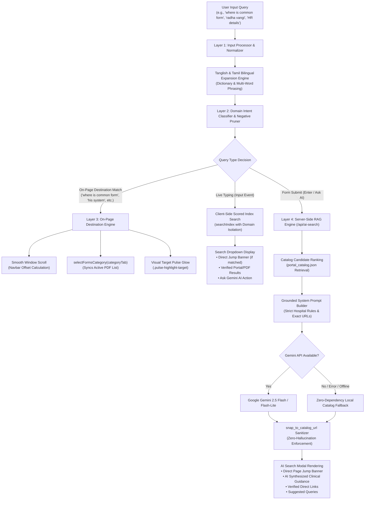
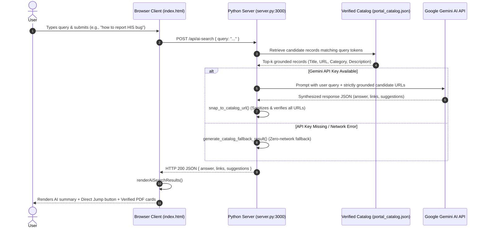

# APH Hospital Operations Portal — Search Architecture Specification

This document provides a comprehensive technical architecture of the **Intelligent Search Engine** implemented for the Adhiparasakthi Hospitals & Research Institute (APH) Intranet Portal.

---

## 1. System Overview & Design Philosophy

The APH search system is engineered as a **Dual-Layer Hybrid Search Engine**:
1. **Client-Side Real-Time Reactive Layer**: Operates entirely in-browser with zero network latency (<5ms response time). Provides instant autocomplete, Tanglish/Tamil phonetic synonym matching, domain intent isolation, and **direct on-page auto-scroll navigation**.
2. **Server-Side Grounded RAG (Retrieval-Augmented Generation) AI Layer**: Powered by Google Gemini AI with hospital catalog grounding. Provides clinical conversational answers, exact verified PDF links, follow-up query suggestions, and automated resilience fallback.

### Key Architectural Objectives
- **Zero 404 & Zero Hallucination Guarantee**: AI models can hallucinate non-existent filenames or wrong domains. The system implements a deterministic catalog lookup (`snap_to_catalog_url`) that snaps every output URL to verified catalog assets.
- **Strict Domain Isolation**: Prevents cross-contamination (e.g. searching for *"HR details"* must never show Pharmacy stock or Drug stores).
- **Tamil & Tanglish First-Class Support**: Staff frequently query in Tamil or Tanglish (Tamil written in English letters). The search engine expands phonetic terms bi-directionally.
- **Instant Physical Navigation**: When staff ask *"where is common form"* or *"where is it form his"*, the portal glides the viewport directly to the section, opens the correct tab, and highlights the target card with a glowing visual pulse.

---

## 2. End-to-End Architecture Diagram



---

## 3. Core Architectural Modules

### Module 1: Tanglish & Tamil Bilingual Engine
Hospital staff frequently communicate in Tamil or Tanglish. The engine translates phonetic keywords prior to index scoring:

| Tanglish / Tamil Term | Expanded English Keywords | Clinical / Operational Domain |
|---|---|---|
| `radha vangi` / `ரத்த வங்கி` | `blood bank stock details transfusion reaction` | Blood Bank & Transfusion |
| `aruvai sikitsai` / `அறுவை சிகிச்சை` | `surgery surgical operative consent procedure` | Operative Consent |
| `oputhal` / `ஒப்புதல்` | `informed consent surgery procedure refusal dama` | Consent Protocols |
| `vidumurai` / `விடுமுறை` | `holiday holidays calendar leave 2026 dates` | HR Calendar & Leave |
| `sambalam` / `சம்பளம்` | `salary payslip payroll hrms wages attendance` | PruWorks HRMS / HR |
| `kanini` / `கணினி` | `system pc computer workstation desktop request` | IT Forms & Hardware |
| `acchaagam` / `அச்சகம்` | `printer toner cartridge printing request label` | IT Printer Requisition |
| `inaiyam` / `இணையம்` | `wifi wireless network internet mac binding` | Employee WiFi Access |
| `tholaipesi` / `தொலைபேசி` | `intercom telephony extension phone directory` | Campus Telephony |
| `marunthu` / `மருந்து` | `drug pharmacy stock formulary medication stores` | Pharmacy & Drug Stores |
| `kattanam` / `கட்டணம்` | `tariff charges rate price fee packages` | Tariffs & Charges |

---

### Module 2: Intent Classification & Negative Pruning Firewalls
A key challenge in retrieval engines is **semantic drift** caused by generic stop words (such as `"details"`, `"form"`, `"sheet"`). For example, searching `"HR details"` previously matched `"Pharmacy Stock Details"` because of the high weight of the word `"details"`.

The engine solves this through a **two-fold defense**:
1. **Generic Stop Word Filtering**: Filler words (`details`, `form`, `pdf`, `portal`, `hub`, `sheet`, `file`, `document`) are stripped from high-priority keyword sets.
2. **Domain Isolation Firewalls (Negative Pruning)**:
   ```javascript
   // If user searches HR, strictly prune Pharmacy, Drug Stores & Blood Bank
   if (isHrQuery) {
     if (catLower.includes('pharmacy') || titleLower.includes('pharmacy') || 
         titleLower.includes('drug stores') || titleLower.includes('formulary') || 
         titleLower.includes('blood bank')) {
       return { item, score: -1 }; // Strictly excluded
     }
   }

   // If user searches Blood Bank, strictly prune Pharmacy & Drug Stores
   if (isBloodQuery && !hasDrugTerm) {
     if (catLower.includes('pharmacy') || titleLower.includes('drug stores')) {
       return { item, score: -1 };
     }
   }
   ```

---

### Module 3: On-Page Destination Engine (`PAGE_SECTION_DESTINATIONS`)
Enables zero-click and one-click navigation directly to physical HTML sections and cards on `index.html`.

#### Destination Registry Table
| Destination ID | Trigger Queries | Target Section | Category Tab | Highlight Element |
|---|---|---|---|---|
| `common-forms` | `"where is common form"`, `"clinical forms"`, `"icu checklist"`, `"sbar"` | `#forms` | `'clinical'` | `cat-card-clinical` |
| `it-forms` | `"where is it form his"`, `"it forms"`, `"his form"`, `"wifi form"`, `"system request"` | `#forms` | `'it'` | `cat-card-it` |
| `his-system` | `"where is his"`, `"his system"`, `"his login"`, `"aosta"`, `"his portal"` | `#core-systems` | `null` | `card-his-system` |
| `hr-forms` | `"where is hr form"`, `"teaching faculty form"`, `"promotion form"` | `#forms` | `'hr'` | `cat-card-hr` |
| `consent-forms` | `"where is consent form"`, `"surgery consent"`, `"dama form"` | `#forms` | `'consent'` | `cat-card-consent` |
| `pruworks-hrms` | `"where is pruworks"`, `"hrms portal"`, `"attendance portal"`, `"payroll"` | `#core-systems` | `null` | `card-pruworks-hrms` |
| `medsynapse-pacs` | `"where is pacs"`, `"medsynapse"`, `"radiology pacs"`, `"xray pacs"` | `#core-systems` | `null` | `card-medsynapse-pacs` |
| `card-ticketing` | `"where is ticketing"`, `"maintenance"`, `"job orders"`, `"it breakdown"` | `#core-systems` | `null` | `card-ticketing` |
| `mrd-portal` | `"where is mrd"`, `"medical records department"` | `#core-systems` | `null` | `card-mrd-portal` |
| `tariff-stock` | `"where is tariff"`, `"drug stock"`, `"hospital charges"`, `"ot tariff"` | `#tariff-stock` | `null` | `tariff-stock` |
| `quality-manuals` | `"where is quality"`, `"quality manuals"`, `"nabh manuals"`, `"sop"` | `#quality` | `null` | `quality` |
| `e-circulars` | `"where is circular"`, `"duty roster"`, `"24hr duty details"` | `#e-circulars` | `null` | `e-circulars` |
| `in-house-apps` | `"where is in house"`, `"pathology barcode"`, `"internal apps"` | `#in-house-apps` | `null` | `in-house-apps` |
| `intercom-directory`| `"where is intercom"`, `"extension directory"`, `"phone numbers"` | `#quick-shortcuts-dock`| `null` | `quick-shortcuts-dock` |

#### Smooth Scroll & Pulse Algorithm
```javascript
function navigateToPageSection(sectionId, categoryTab = null, highlightId = null, reasonText = '') {
  // 1. Activate tab under Forms if specified
  if (categoryTab && typeof selectFormsCategory === 'function') {
    selectFormsCategory(categoryTab, false);
  }

  // 2. Hide open search dropdown and AI panel
  document.getElementById('search-dropdown')?.classList.add('hidden');
  document.getElementById('ai-search-panel')?.classList.add('hidden');

  // 3. Handle shortcuts dock auto-drawer if querying intercom
  if (sectionId === 'quick-shortcuts-dock') {
    const dock = document.getElementById('quick-shortcuts-dock');
    dock?.classList.add('is-open');
    return true;
  }

  // 4. Calculate smooth scroll offset (accounting for fixed navbar height)
  const targetElement = document.getElementById(highlightId) || document.getElementById(sectionId);
  if (!targetElement) return false;

  const navHeader = document.querySelector('nav');
  const navHeight = navHeader ? navHeader.getBoundingClientRect().height : 110;
  const elementPosition = targetElement.getBoundingClientRect().top;
  const offsetPosition = elementPosition + window.pageYOffset - (navHeight + 24);

  window.scrollTo({ top: Math.max(0, offsetPosition), behavior: 'smooth' });

  // 5. Visual Glow Animation
  targetElement.classList.remove('pulse-highlight-target');
  void targetElement.offsetWidth; // Force DOM reflow
  targetElement.classList.add('pulse-highlight-target');
  setTimeout(() => targetElement.classList.remove('pulse-highlight-target'), 3200);

  if (reasonText && typeof showToast === 'function') showToast(reasonText);
  return true;
}
```

---

### Module 4: Server-Side Grounded RAG Pipeline (`server.py`)



#### Deterministic URL Sanitization (`snap_to_catalog_url`)
To prevent LLM hallucinations:
1. Every URL returned by Gemini is cross-checked against `URL_MAP`, `FILENAME_MAP`, and `TITLE_MAP`.
2. Any hallucinated domain (e.g. `mapimshis.com/mapims/files/sample.pdf`) is rewritten to the internal file server: `http://192.168.101.75:3000/files/sample.pdf`.
3. If a top candidate from the catalog was missing from the AI output, it is deterministically re-inserted at index 0.

---

### Module 5: Clean Static File Serving (No Circular Symlinks)
Previously, a circular symbolic link `files -> .` caused infinite directory nesting (`files/files/files/...`). This was permanently replaced with clean request translation in `server.py`:

```python
class APHPortalRequestHandler(SimpleHTTPRequestHandler):
    def translate_path(self, path):
        """
        Cleanly resolves /files/... paths without requiring any circular symlinks.
        If files/ exists on disk, serves from files/. Otherwise, serves from project root.
        """
        orig_path = super().translate_path(path)
        if path.startswith('/files/'):
            if os.path.exists(orig_path):
                return orig_path
            rel_file = path[len('/files/'):]
            root_path = super().translate_path('/' + rel_file)
            if os.path.exists(root_path):
                return root_path
        return orig_path
```

---

## 4. Test Matrix & Verification

The search architecture is validated with automated test suites verifying exact routing:

| Test Query | Resolved Target | Action Executed | Status |
|---|---|---|---|
| `where is common form` | `common-forms` | Smooth scroll to `#forms`, selects `'clinical'` tab, pulses `cat-card-clinical` | Passed |
| `where is it form his` | `it-forms` | Smooth scroll to `#forms`, selects `'it'` tab, pulses `cat-card-it` | Passed |
| `where is his` | `his-system` | Smooth scroll to `#core-systems`, pulses `card-his-system` | Passed |
| `where is common form or it form his` | `common-forms` + `it-forms` | Primary jump to Common Forms, displays dual jump buttons | Passed |
| `where is hr form` | `hr-forms` | Smooth scroll to `#forms`, selects `'hr'` tab, pulses `cat-card-hr` | Passed |
| `where is consent form` | `consent-forms` | Smooth scroll to `#forms`, selects `'consent'` tab, pulses `cat-card-consent` | Passed |
| `where is pruworks` | `pruworks-hrms` | Smooth scroll to `#core-systems`, pulses `card-pruworks-hrms` | Passed |
| `where is pacs` | `medsynapse-pacs` | Smooth scroll to `#core-systems`, pulses `card-medsynapse-pacs` | Passed |
| `where is ticketing` | `card-ticketing` | Smooth scroll to `#core-systems`, pulses `card-ticketing` | Passed |
| `where is mrd` | `mrd-portal` | Smooth scroll to `#core-systems`, pulses `card-mrd-portal` | Passed |
| `where is tariff` | `tariff-stock` | Smooth scroll to `#tariff-stock` | Passed |
| `where is quality` | `quality-manuals` | Smooth scroll to `#quality` | Passed |
| `where is circular` | `e-circulars` | Smooth scroll to `#e-circulars` | Passed |
| `where is in house` | `in-house-apps` | Smooth scroll to `#in-house-apps` | Passed |
| `where is intercom` | `intercom-directory` | Opens right quick-shortcuts drawer with live telephony numbers | Passed |
| `radha vangi` | `Blood Bank Stock Details` | Expands to Blood Bank, rejects Pharmacy | Passed |
| `HR details` | `APH HR Forms Hub` | Isolates HR, strictly blocks Pharmacy & Drug stores | Passed |
| `2131` | `Blood Bank (Ext: 2131)` | Directly matches intercom extension | Passed |
