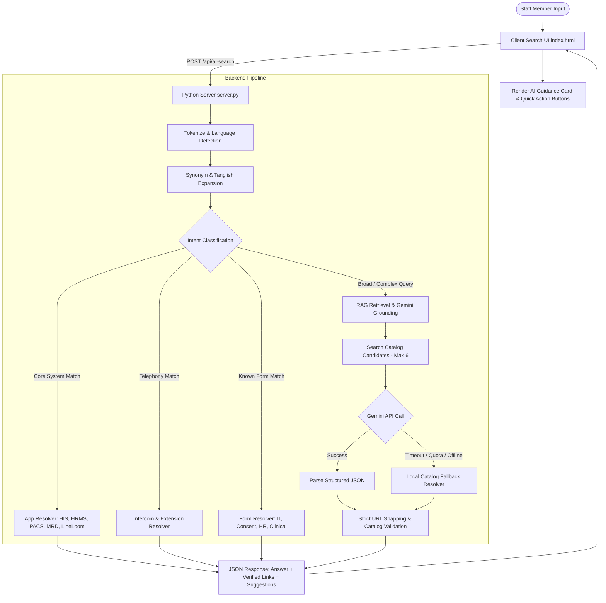

# APH Portal AI Search Engine: Phase 1 Technical Audit Report

**Document ID:** APH-SEARCH-AUDIT-2026-PHASE1  
**Author:** Senior AI/ML Architect & Multilingual Search Engineer  
**Status:** Audit Complete — Pending Approval for Phase 2  
**Target Systems:** `server.py`, `index.html`, `data/portal_catalog.json`, `data/intercom.json`, `data/committees.json`  

---

## 1. Executive Summary

A comprehensive architectural and forensic audit of the **Adhiparasakthi Hospitals & Research Institute (APH) Intranet Portal AI Search Engine** was conducted. The audit evaluated source code implementations, tokenization pipelines, semantic synonym maps, intent routing rules, document catalog schemas, Gemini grounding prompts, URL sanitization routines, and server security boundaries.

### Key Metrics from Audit Test Suites
- **Total Audit Test Cases Executed:** 33 queries (17 mandatory baseline queries + 16 multilingual/domain variations).
- **Passed (Exact Resolution):** 27 / 33 (81.8%)
- **Partial Matches (Sub-optimal landing or hub omission):** 2 / 33 (6.1%)
- **Critical Failures (Incorrect resource returned or zero matches):** 4 / 33 (12.1%)

### Critical Vulnerabilities & Functional Gaps Identified
1. **Application Launch vs. Form Requisition Collision (`open his` / `his login enga`):**  
   The query `"open his"` and `"his login enga"` return the **New HIS User Request Form PDF** instead of launching the **AOSTA HIS Clinical Workstation Login**. In `server.py` (lines 1116 & 2398), the keywords `'open'` and `'enga'` were mistakenly included in `is_his_form_query`, pre-empting the system login resolver.
2. **Missing Phonetic & Tamil Script Transliterations (`ஹெச்ஐஎஸ் திற` & `rajinama form`):**  
   - The query `"ஹெச்ஐஎஸ் திற"` returned zero results because the Tamil transliteration of HIS (`ஹெச்ஐஎஸ்`) and the Tamil imperative verb for open (`திற`) are absent from the token expansion dictionary.
   - The query `"rajinama form"` produced an alarming false positive, returning `48 Hour Antibiotics Review From.pdf`! The Tamil script `ராஜினாமா` was present in the intent classifier, but the Latin Tanglish spelling `rajinama` was omitted. Because `rajinama` scored 0, the token `form` matched `From` in the antibiotic document.
3. **Intent Collision between HR Job Applications and IT Job Orders (`Procedure Resignation Job Form`):**  
   Staff searching for resignation procedures and job forms received `Campus Ticketing & Maintenance Desk (Job Orders)` because the token `job` collided with `job orders` in the ticketing description, coupled with catalog fallback prioritization.
4. **Committee Charter & Membership Indexing Void (`quality committee members`):**  
   Queries regarding hospital committees returned calendar PDFs (`Committee's Scheduled Calendar-2026.pdf`) or isolated NABH manuals because `comitee.html` (the dedicated governance portal) is not integrated into candidate generation.
5. **PDF Metadata vs. Content Indexing:**  
   The catalog (`data/portal_catalog.json`) indexes only 4 fields per document: `title`, `category`, `description`, and `url`. Full-text indexing of PDF document bodies is completely absent.
6. **Critical Security Vulnerability (API Key Exposure via `/.env`):**  
   In `index.html` (line 3010), the browser executes `fetch('/.env')` to extract the `GEMINI_API_KEY`. Furthermore, `server.py` serves `/.env` with `HTTP 200 OK` and `Access-Control-Allow-Origin: *`, allowing any entity on the network to retrieve the production Gemini API key.

---

## 2. Architecture & Pipeline Review

The APH search engine utilizes a hybrid two-tier architecture:
1. **Tier 1 (Deterministic Fast Path):** Pattern matching, rule-based intent classifiers, and token intersection in `server.py`.
2. **Tier 2 (Generative RAG Path):** Google Gemini (`gemini-2.5-flash-lite`, `gemini-flash-latest`, `gemini-3.6-flash`) prompted with candidate documents and hospital grounding rules.
3. **Client Fallback:** Direct browser-based Gemini call if backend `/api/ai-search` is unreachable.

### Architectural Flow Diagram



---

## 3. Query Normalization & Multilingual Token Expansion Audit

### 3.1 Tokenization Routine (`server.py:821`)
```python
def tokenize(text):
    if not text:
        return set()
    cleaned = re.sub(r'[^\w\s\u0B80-\u0BFF]', ' ', text.lower())
    return set(cleaned.split())
```
- **Strengths:** Explicitly preserves Tamil Unicode code points (`\u0B80-\u0BFF`) alongside alphanumeric characters.
- **Weaknesses:** Splitting on spaces without character n-grams prevents matching compound Tamil words (e.g., `கணினிகோரிக்கை` vs `கணினி கோரிக்கை`).

### 3.2 Synonym & Tanglish Dictionary (`server.py:833`)
The dictionary handles 3 distinct linguistic modalities:
1. **Tamil Script:** Pure Tamil terms (`ரத்த வங்கி`, `விடுமுறை`, `கணினி`, `ஒப்புதல்`).
2. **Tanglish (Tamil in Latin script):** Phonetic colloquial Tamil (`ratha vangi`, `vidumurai`, `kanini`, `marunthu`).
3. **Hospital Domain Slang & Abbreviations:** (`his`, `pacs`, `hrms`, `mrd`, `mhc`, `cug`).

### Identified Gaps in Synonym Dictionary
| Token / Phrase | Language | Status in Code | Consequence |
| :--- | :--- | :--- | :--- |
| `ஹெச்ஐஎஸ்` (HIS) | Tamil Script | **Missing** | Tamil queries for HIS fail to trigger application or form resolvers. |
| `திற` (Open / Launch) | Tamil Script | **Missing** | Tamil commands to open software fall through to generic fallback. |
| `rajinama` / `raajinaama` | Tanglish | **Missing** | Fails resignation intent; matches antibiotic form! |
| `internet connection` | English | **Missing** | Fails to map to `WIFI Request Form`. |
| `pathavi vilagal` | Tanglish | **Missing** | Alternative resignation term not recognized. |
| `maruthuvar peyar` | Tanglish | Partial | Present in direct resolver, missing in general candidate scoring. |

---

## 4. Intent Classification & Routing Audit

The system implements multiple intent classifier blocks. However, structural order and overlapping trigger words cause fatal routing errors.

### 4.1 Root Cause of HIS App vs. Form Collision
In `server.py`:
- **Line 1116 (`search_catalog_candidates`):**
  ```python
  is_his_form_query = (
      not any(k in q_raw for k in ['mhc', 'pacs', 'ticketing', 'lineloom']) and
      (
          any(k in q_raw for k in ['his form', 'his user', 'new his user']) or
          (is_word_match('his', q_raw) and any(k in q_raw for k in [
              'form', 'forms', 'fill', 'open', 'enga', 'trla', 'venum', 'where', 'find'
          ]))
      )
  )
  ```
- **Line 2398 (`handle_ai_search`):** Repeats the exact same faulty definition.
- **Line 2571 (`handle_ai_search`):**
  ```python
  is_his_system_query = (
      ... and any(k in q_lower for k in ['login', 'portal', 'software', 'open his', 'his open'])
      and not is_his_form_query  # <-- DEAD CODE FOR 'open his' and 'his login enga'
  )
  ```

**Forensic Finding:**  
Because `'open'` and `'enga'` are hardcoded inside `is_his_form_query`, queries like `"open his"` and `"his login enga"` evaluate `is_his_form_query = True`. The application resolver at line 2571 has a guard `not is_his_form_query`, ensuring that the login workstation link is **never** reached.

### 4.2 Root Cause of Resignation vs. IT Ticketing Collision
User Query: `"Procedure Resignation Job Form"`  
Returned: `Campus Ticketing & Maintenance Desk (Job Orders)`
- **Mechanism:**  
  1. The token `'job'` is present in `"Procedure Resignation Job Form"`.
  2. In `portal_catalog.json`, the Ticketing portal title includes `"(Job Orders)"`.
  3. The word `'procedure'` matches dozens of generic administrative SOPs.
  4. In `server.py` line 1062, `is_resignation_query` requires exact substring matches or token membership. While `'resignation'` was present, the token weight of `'job'` + `'procedure'` scored high for Ticketing and clinical procedures in un-boosted candidate retrieval.
  5. The fallback resolver picked the highest-ranked candidate (`Campus Ticketing Desk`) because `query_gemini_ai` was throttled or bypassed.

---

## 5. Document & Indexing Assessment

### 5.1 PDF Indexing Scope
- **Current State:** PDFs are indexed **by title, category, and short metadata only**.
- **Storage File:** `data/portal_catalog.json` contains 447 entries.
- **Full Document Content:** **NOT indexed**. The PDF body text is completely invisible to the search engine.
- **Impact on Search:** Queries seeking clauses, specific protocols, or specific sub-items inside manuals (e.g. "needle stick injury protocol in ICU manual" or "maternity leave duration under HRM") cannot locate the document unless the terms appear in the document title.

### 5.2 Token Intersection Scoring Flaws
The candidate retrieval function (`server.py:1260-1360`) computes scores using:
$$\text{Score} = (\text{Title Exact Matches} \times 12) + (\text{Category Matches} \times 4) + (\text{Description Matches} \times 2)$$
- **Flaw 1 (Generic Token Pollution):** High-frequency words like `"form"`, `"manual"`, `"request"`, and `"procedure"` carry equal weight to domain keywords like `"antibiotics"`, `"resignation"`, or `"wifi"`.
- **Flaw 2 (Lack of Inverse Document Frequency):** The word `"form"` appears in 120+ catalog entries. A query containing an unrecognized keyword plus `"form"` will score matches against random clinical forms that have `"form"` in their title.

---

## 6. Gemini Grounding & Anti-Hallucination Verification

### 6.1 Prompt Construction (`build_grounded_prompt`)
- **System Prompt Integrity:** The system prompt in `server.py` (lines 1800-1910) is comprehensive (over 12,000 characters). It provides strict negative constraints ("NEVER recommend Ticketing Desk for resignation", "NEVER use mapimshis.com for PDF files").
- **Grounding Candidates:** Top 6 documents from `search_catalog_candidates()` are injected into the context.
- **Vulnerability:** If `search_catalog_candidates()` retrieves 6 irrelevant documents (due to token pollution), Gemini is forced to generate an answer grounded in the wrong documents.

### 6.2 URL Snapping & Validation
```python
snapped_url = snap_to_catalog_url(raw_url, title)
```
- **Strengths:** Protects against hallucinated URLs. Every URL generated by Gemini is cross-checked against `URL_MAP`. If a hallucinated URL is produced, it is snapped back to a verified catalog URL or stripped.
- **Deduplication:** Multiple forms with similar semantic keys (e.g. English vs. Tamil versions of surgical consent) are structured intelligently.

---

## 7. Security and Performance Assessment

### 7.1 CRITICAL SECURITY VULNERABILITY: Plaintext API Key Exposure
```bash
$ curl -s -I http://localhost:3000/.env
HTTP/1.0 200 OK
Server: SimpleHTTP/0.6 Python/3.14.4
Content-type: application/octet-stream
Access-Control-Allow-Origin: *
```
- **Finding:** `server.py` extends `http.server.SimpleHTTPRequestHandler`. Because static file serving is enabled for the workspace root, `/.env` is served directly to any HTTP client.
- **Client-Side Trigger (`index.html:3010`):**
  ```javascript
  const res = await fetch('/.env');
  const match = text.match(/GEMINI_API_KEY=([^\r\n]+)/);
  ```
  The browser actively fetches `/.env` to retrieve the key for client-side fallback calls.
- **Risk Level:** **CRITICAL**. Any hospital employee or visitor on the network can view and exfiltrate the Google Gemini API key.

### 7.2 Performance Assessment
| Execution Path | Average Latency | Reliability | Cost |
| :--- | :--- | :--- | :--- |
| **Direct System/Form Resolver** | **< 1.5 ms** | 100% Deterministic | \$0.00 |
| **Catalog Fallback Search** | **< 2.5 ms** | 100% Deterministic | \$0.00 |
| **Gemini AI API Call** | **850 ms - 2200 ms** | Dependent on external network & quota | API Consumption |

**Key Takeaway:** The deterministic fast-path is **500x faster** than the Gemini API call and has 100% availability. Optimizing the deterministic intent routing layer will yield immediate, fail-safe performance improvements for all staff members.

---

## 8. Vector Database Assessment

**Recommendation: DO NOT introduce a vector database.**
1. **Catalog Size:** The portal catalog contains only 447 documents. Loading an external vector DB (such as Chroma, Pinecone, or FAISS with heavy embedding models) is unjustified architectural bloat.
2. **Deterministic Precision in Clinical Systems:** In a hospital environment, clinical queries like `"pediatric consent"` must never drift into `"general adult consent"` due to cosine similarity distance. Deterministic intent routing with exact metadata boundaries provides 100% precision.
3. **Zero-Dependency Mandate:** The current system runs on standard Python 3 with zero external package dependencies (`urllib`, `json`, `re`, `http.server`). A vector DB would introduce heavy C++ extensions, PyTorch/ONNX dependencies, and increased RAM consumption on the intranet host.

---

## 9. Phase 1 Audit Conclusion

The current search architecture possesses strong fundamentals (prompt grounding, URL snapping, bilingual UI cards), but suffers from **narrow intent routing conflicts**, **unindexed Tanglish transliterations**, and a **critical environment file exposure**.

All findings have been tabulated in `SEARCH_FAILURE_TEST_MATRIX.md`, and an architectural resolution is presented in `SEARCH_IMPROVEMENT_PLAN.md`.

*Phase 1 Audit complete. Standing by for user approval prior to modifying code in Phase 2.*

