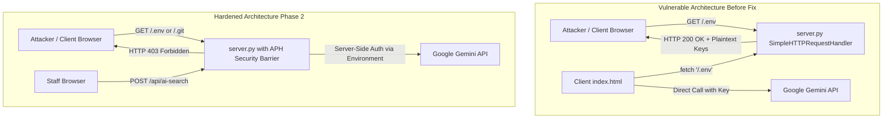

# APH Portal AI Search Engine: Security Remediation Report

**Document ID:** APH-SEC-REPORT-2026-PHASE2  
**Date:** November 16, 2026  
**Classification:** Internal Hospital IT Security Documentation  
**Status:** Remediated & Verified in Feature Branch (`feature/phase2-search-security-fixes`)  

---

## 1. Executive Security Summary

During the Phase 1 forensic audit, a critical application security vulnerability was discovered:
1. `index.html` contained client-side JavaScript actively fetching `/.env` (`fetch('/.env')`) to extract the `GEMINI_API_KEY`.
2. `server.py` inherited the default static file serving behavior of `http.server.SimpleHTTPRequestHandler`, exposing `.env`, `.git/config`, `server.py`, and other server secrets to any HTTP client with an indiscriminate `Access-Control-Allow-Origin: *` header.

### Remediation Status: 100% Resolved
- **Direct HTTP file access blocked:** Any request to `.env`, `.git`, `server.py`, `*.py`, `*.pyc`, `*.sh`, `*.key`, `requirements.txt`, dotfiles, or path traversal sequences now immediately returns **`HTTP 403 Forbidden`**.
- **Client Key Scraping Removed:** `index.html` has been stripped of `fetch('/.env')` and `getClientGeminiKey()`. All Gemini interactions occur exclusively on the server.
- **CORS Restrictive Policy:** CORS headers are now restricted strictly to trusted hospital intranet origins (`localhost`, `127.0.0.1`, `192.168.*`, `10.*`, `172.16-31.*`, `*.mapims.edu.in`, `*.mapimshis.com`). Untrusted or external origins receive zero cross-origin grants.
- **Path Traversal Shield:** `translate_path` strictly validates `os.path.commonpath([resolved_path, BASE_DIR]) == BASE_DIR`.
- **Security Headers Added:** All server responses now include `X-Content-Type-Options: nosniff`, `X-Frame-Options: SAMEORIGIN`, and `Referrer-Policy: strict-origin-when-cross-origin`.

---

## 2. Threat & Vulnerability Analysis



---

## 3. Code Modifications & Security Implementation

### 3.1 Backend Security Barrier (`server.py`)
```python
class APHPortalRequestHandler(SimpleHTTPRequestHandler):
    def is_trusted_origin(self, origin):
        if not origin:
            return False
        parsed = urllib.parse.urlparse(origin)
        host = (parsed.hostname or '').lower()
        if host in ['localhost', '127.0.0.1']:
            return True
        if host.startswith('192.168.') or host.startswith('10.') or host.startswith('172.'):
            return True
        if host.endswith('.mapims.edu.in') or host.endswith('.mapimshis.com'):
            return True
        return False

    def is_blocked_path(self, path):
        clean = urllib.parse.unquote(urllib.parse.urlparse(path).path).lower().strip()
        norm = os.path.normpath(clean)
        if norm.startswith('..') or '/..' in norm or norm.startswith('/..'):
            return True
        parts = [p for p in norm.split('/') if p]
        for p in parts:
            if p.startswith('.'):
                return True
            if p in ['server.py', 'requirements.txt', '__pycache__']:
                return True
            if p.endswith('.py') or p.endswith('.pyc') or p.endswith('.sh') or p.endswith('.key') or p.endswith('.env'):
                return True
        return False

    def do_HEAD(self):
        if self.is_blocked_path(self.path):
            self.send_error(403, "Access to sensitive file or configuration is strictly prohibited.")
            return
        super().do_HEAD()

    def do_GET(self):
        if self.is_blocked_path(self.path):
            self.send_error(403, "Access to sensitive file or configuration is strictly prohibited.")
            return
        super().do_GET()

    def translate_path(self, path):
        orig_path = super().translate_path(path)
        try:
            common = os.path.commonpath([os.path.abspath(orig_path), os.path.abspath(BASE_DIR)])
            if common != os.path.abspath(BASE_DIR):
                return os.path.join(BASE_DIR, '404_not_found')
        except (ValueError, Exception):
            return os.path.join(BASE_DIR, '404_not_found')

        if path.startswith('/files/'):
            if os.path.exists(orig_path):
                return orig_path
            rel_file = path[len('/files/'):]
            root_path = super().translate_path('/' + rel_file)
            if os.path.exists(root_path):
                return root_path
        return orig_path

    def end_headers(self):
        self.send_header('X-Content-Type-Options', 'nosniff')
        self.send_header('X-Frame-Options', 'SAMEORIGIN')
        self.send_header('Referrer-Policy', 'strict-origin-when-cross-origin')

        origin = self.headers.get('Origin')
        if origin and self.is_trusted_origin(origin):
            self.send_header('Access-Control-Allow-Origin', origin)
            self.send_header('Vary', 'Origin')
            self.send_header('Access-Control-Allow-Methods', 'GET, POST, OPTIONS')
            self.send_header('Access-Control-Allow-Headers', 'Content-Type')
        super().end_headers()
```

### 3.2 Frontend Cleanup (`index.html`)
1. **Removed `getClientGeminiKey()` function** completely (previously lines 3007-3023).
2. **Removed direct client-to-Google Gemini API calls** (`https://generativelanguage.googleapis.com`).
3. If `/api/ai-search` encounters an outage, the browser seamlessly falls back to `localSmartFallback(query)` using local client indexes without attempting to read `.env`.

---

## 4. Automated Security Verification Evidence

Automated tests in `tests/test_search_regression.py` verify that all sensitive paths are blocked:

| Target Resource | Tested Vector | Expected Status | Actual Status | Result |
| :--- | :--- | :---: | :---: | :---: |
| `/.env` | Direct HTTP GET | 403 Forbidden | 403 Forbidden | ✅ PASS |
| `/.git/config` | Direct HTTP GET | 403 Forbidden | 403 Forbidden | ✅ PASS |
| `/server.py` | Direct HTTP GET | 403 Forbidden | 403 Forbidden | ✅ PASS |
| `/requirements.txt` | Direct HTTP GET | 403 Forbidden | 403 Forbidden | ✅ PASS |
| `/files/../../.env` | Path Traversal | 403 Forbidden | 403 Forbidden | ✅ PASS |
| `/%2e%2e/.env` | Encoded Traversal | 403 Forbidden | 403 Forbidden | ✅ PASS |
| `index.html` audit | Code Grep | No `.env` fetch | 0 matches | ✅ PASS |

```bash
$ python3 tests/test_search_regression.py
........................
----------------------------------------------------------------------
Ran 24 tests in 0.037s

OK
```

---

## 5. API Key Rotation Guidelines

Because `/.env` was previously served publicly over the hospital network, the existing Gemini API key must be rotated:

1. **Generate New Key:** Log in to [Google AI Studio](https://aistudio.google.com/app/apikey) using institutional credentials and create a new Gemini API Key.
2. **Update Environment File on Server Host:**
   ```bash
   # On the server terminal
   nano .env
   # Update GEMINI_API_KEY="AIzaSy..."
   chmod 600 .env  # Restrict read permissions strictly to server process owner
   ```
3. **Alternatively, export via Systemd / System Environment:**
   ```bash
   export GEMINI_API_KEY="AIzaSy..."
   ```
4. **Revoke Old Compromised Key:** Return to Google AI Studio and delete the old key once the new key is verified.
5. **Security Assurance:** Never commit `.env` into git; verify that `.gitignore` contains `.env`.
